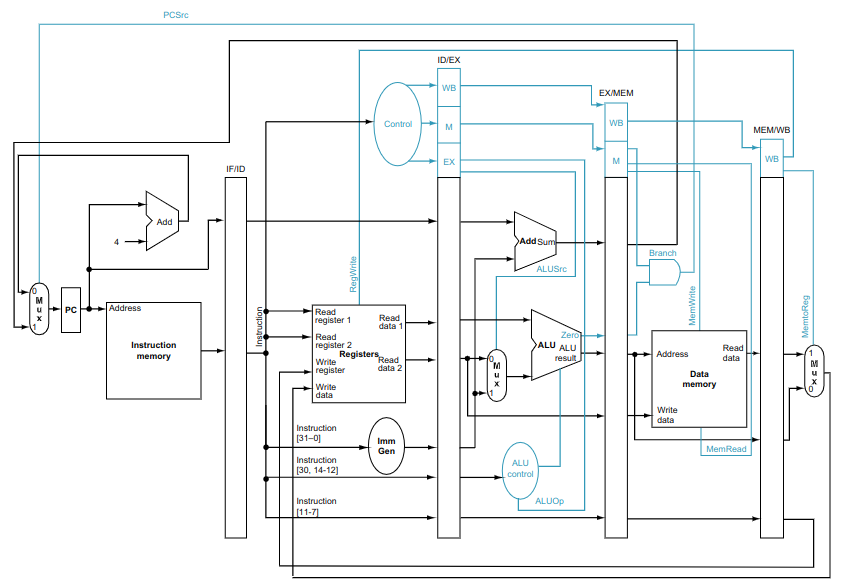

# RISC-V 5-Stage Pipeline Simulator

A cycle-accurate simulator of a classic 5-stage pipelined RISC-V (RV32I + `mul`/`mulh`) processor, written in C. It was built for ENSC 254 (Introduction to Computer Organization) at Simon Fraser University. The project was done in two milestones:

| Milestone | Folder | Scope |
|-----------|--------|-------|
| **MS1** | [`ms1_fin/`](ms1_fin) | Basic 5-stage pipeline (IF → ID → EX → MEM → WB): control generation, ALU control, branch resolution, no hazard handling |
| **MS2** | [`ms2_fin/`](ms2_fin) | MS1 plus hazard detection and resolution: EX/MEM and MEM/WB forwarding, load-use stalls, and pipeline flushes on taken branches |



---

## Project structure

```
ms1_fin/ , ms2_fin/
├── pipeline.c / pipeline.h     # Pipeline stages (fetch, decode, execute, memory, writeback) and the cycle loop
├── stage_helpers.h             # gen_control, gen_alu_control, gen_branch, forwarding and hazard helpers
├── emulator.c                  # Functional (golden) emulator
├── riscv.c / riscv.h           # Entry point and command-line handling
├── disasm.c, utils.c, cache.c  # Disassembler, instruction parsing and decoding, cache model
├── config.h                    # Debug and trace switches (DEBUG_REG_TRACE, DEBUG_CYCLE, PRINT_STATS, MEM_LATENCY)
├── code/ms1, code/ms2          # Test programs (input/), reference traces (ref/), generated output (out/)
└── test_simulator_ms*.sh       # Scripts that run the tests and diff the output against the reference traces
```

## Building and running

Requirements: `gcc` and `make` (Linux, macOS or WSL).

```bash
cd ms2_fin            # or ms1_fin
make                  # builds ./riscv
./riscv -s -f ./code/ms2/input/R/R.input            # pipeline simulator with forwarding
./riscv -s -e -f ./code/ms2/input/multiply.input    # same, exits when the program ends
```

Useful flags: `-s` runs the pipeline simulator (without it, the functional emulator runs), `-f` turns on forwarding, `-e` exits at program end, `-d` disassembles, `-r` dumps the registers, `-c` turns on the cache model, `-i`/`-t` run interactively.

### Running the tests

Set the switches in `config.h` for the milestone you are testing. MS2 needs `DEBUG_REG_TRACE`, `DEBUG_CYCLE`, `PRINT_STATS` and `MEM_LATENCY 0`. Then run:

```bash
bash test_simulator_ms1.sh   # milestone 1
bash test_simulator_ms2.sh   # milestone 2: diffs code/ms2/out/* against code/ms2/ref/*
```

An empty diff means the test passed.

---

## Milestone 1: Basic pipeline

### Control logic (ID stage)
`gen_control` in `stage_helpers.h` reads the instruction's opcode to find its type (R, I, S, B, U, J) and sets these control signals:

- `reg_write`: the instruction writes to `rd`
- `mem_read` / `mem_write`: the instruction reads from or writes to memory
- `branch`: the instruction is a branch
- `alu_src`: the ALU's second operand is the immediate (`true`) or `rs2` (`false`)
- `rd_idx`: the destination register (0 when nothing is written)

### IF-stage mux
In `stage_fetch` (`pipeline.c`), the `pcsrc` signal picks between the **branch target** (`pc_src1`) and the **sequential PC** (`pc_src0 = PC + 4`). The chosen value becomes the PC for the next cycle.

### EX-stage mux
In `stage_execute`, `idex_reg.alu_src` picks the ALU's second operand: either `idex_reg.immediate` or `idex_reg.rs2_data`.

LUI and AUIPC are handled separately:
- **LUI**: `alu_inp1 = 0`
- **AUIPC**: `alu_inp1 = PC`

For both, `alu_inp2` is selected the normal way.

### `alu_op` encoding

| Operation | funct3 | funct7 | `alu_op` |
|-----------|--------|--------|----------|
| ADD / ADDI | 0x0 | 0x00 / – | 0x0 |
| SUB | 0x0 | 0x20 | 0x1 |
| SLT / SLTI | 0x2 | 0x00 / – | 0x2 |
| SLTU / SLTIU | 0x3 | 0x00 / – | 0x3 |
| XOR / XORI | 0x4 | 0x00 / – | 0x4 |
| OR / ORI | 0x6 | 0x00 / – | 0x6 |
| AND / ANDI | 0x7 | 0x00 / – | 0x7 |
| SLL / SLLI | 0x1 | 0x00 / – | 0x8 |
| SRL / SRLI | 0x5 | 0x00 / – | 0x9 |
| SRA / SRAI | 0x5 | 0x20 / – | 0xA |
| MUL | 0x0 | 0x01 | 0xB |
| MULH | 0x1 | 0x01 | 0xC |
| Loads, stores, LUI, AUIPC, JAL | – | – | 0x0 (add) |
| BEQ / BNE | 0x0 / 0x1 | – | 0x1 (sub) |
| BLT / BGE | 0x4 / 0x5 | – | 0x2 (slt) |
| BLTU / BGEU | 0x6 / 0x7 | – | 0x3 (sltu) |

### Branch resolution
`gen_branch` checks that the opcode is a branch (`0x63`), then compares `rs1_data` and `rs2_data` according to `funct3`:

| Branch | funct3 | Condition |
|--------|--------|-----------|
| BEQ | 0x0 | `rs1 == rs2` |
| BNE | 0x1 | `rs1 != rs2` |
| BLT | 0x4 | `(int32_t)rs1 < (int32_t)rs2` |
| BGE | 0x5 | `(int32_t)rs1 >= (int32_t)rs2` |
| BLTU | 0x6 | `rs1 < rs2` (unsigned) |
| BGEU | 0x7 | `rs1 >= rs2` (unsigned) |

---

## Milestone 2: Hazard detection and resolution

### Data forwarding
- **EX hazard** (forward from EX/MEM): applies when `exmem.reg_write` is set, `exmem.rd_idx != 0`, and `idex.rs1_idx` or `idex.rs2_idx` equals `exmem.rd_idx`. This sets `forward_rsX = 0x1`.
- **MEM hazard** (forward from MEM/WB): applies when the needed value is in MEM/WB and no EX hazard matches. This sets `forward_rsX = 0x2`.
- In `stage_execute`, EX forwarding takes priority over MEM forwarding. Stores also receive the forwarded `rs2` value, so the most recent data gets written to memory.

### Load-use stalls
A stall is inserted when the instruction in ID/EX is a load (`idex.mem_read`) and the instruction in IF/ID reads that load's destination register (and the register is not `x0`). On a stall, the simulator:
1. Holds the IF/ID register (`ifid_stall`)
2. Inserts a bubble (NOP, `0x00000013`) into ID/EX (`idex_bubble`)
3. Keeps the PC unchanged, so the same instruction is fetched again

### Control hazards (flush)
When a branch is taken (resolved in EX), the simulator sets the `flush` signal, writes NOPs into the IF/ID, ID/EX and EX/MEM registers, and sets the PC to `exmem.branch_target`.

### Interface change
`stage_execute` now also receives the pipeline registers, so it can read EX/MEM and MEM/WB values for forwarding, hazard detection and flushing:

```c
// MS1
exmem_reg_t stage_execute(idex_reg_t idex_reg, pipeline_wires_t* pwires_p);
// MS2
exmem_reg_t stage_execute(idex_reg_t idex_reg, pipeline_regs_t* pregs_p, pipeline_wires_t* pwires_p);
```

---

## Contributors

- **Jaswinder Singh**
- **Hassan Sheref**
